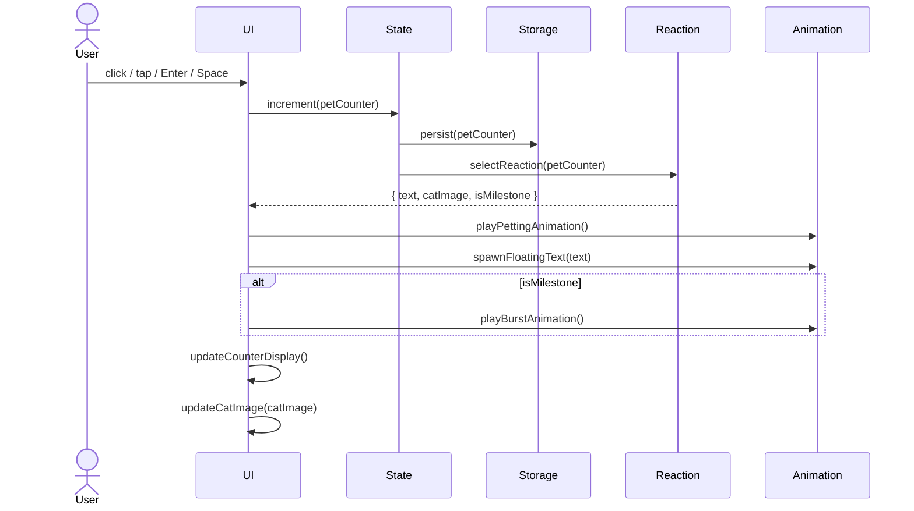

# Design Document

## Overview

The cat-clicker app is a self-contained, single-page web application delivered as one HTML file. Users click or tap a minimalist ASCII/emoji cat to increment a persistent pet counter and trigger randomised visual reactions. The experience is intentionally lightweight: no build step, no backend, no JavaScript framework — just HTML, [Tailwind CSS via CDN](https://tailwindcss.com/docs/installation/play-cdn), and vanilla JavaScript.

Key design goals:
- **Zero-dependency runtime** — everything ships inside one `.html` file; the only external reference is the Tailwind CSS CDN `<script>`.
- **Persistent progress** — the pet counter survives tab-close via `localStorage`.
- **Delightful feedback loop** — randomised reactions, expression changes, floating text, and milestone celebrations keep the interaction fresh.
- **Accessibility-first** — the cat element is keyboard-operable and screen-reader labelled from day one.

---

## Architecture

Because there is no build step and no module bundler, the entire application is structured as a single HTML file with three logical sections that are strictly separated by responsibility:

```
index.html
├── <head>              — Tailwind CDN, global CSS animation keyframes
├── <body>              — Semantic HTML markup only; no inline logic
└── <script>            — All application logic as a single IIFE
    ├── State module     — Single source-of-truth object
    ├── Storage module   — localStorage read/write with error handling
    ├── Reaction module  — Reaction pool, milestone set, selection logic
    ├── Animation module — Petting animation, floating text, burst effects
    └── UI module        — DOM queries, render helpers, event wiring
```

The script section is wrapped in an immediately-invoked function expression (IIFE) to avoid polluting `window`. All DOM manipulation is centralised in the UI module so the other modules stay pure and testable.

### Data flow



---

## Components and Interfaces

### 1. State

A plain JavaScript object that is the single source of truth.

```js
// Internal shape — not exported, mutated only through State helpers
const state = {
  petCount: 0,              // integer, 0–999999999
  triggeredMilestones: [],  // array of milestone values already fired
};
```

**Interface:**

| Function | Signature | Description |
|---|---|---|
| `initState()` | `() → void` | Reads from Storage, populates `state`. |
| `increment()` | `() → number` | Increments `petCount`, persists, returns new value. |
| `isMilestone(n)` | `(number) → boolean` | Returns `true` if `n` is a defined milestone not yet triggered. |
| `markMilestone(n)` | `(number) → void` | Records `n` in `triggeredMilestones` and persists it. |

---

### 2. Storage

Thin wrapper around `localStorage`. All calls are wrapped in `try/catch` so a `SecurityError` or `QuotaExceededError` degrades gracefully.

```js
const Storage = {
  get(key)        { /* returns parsed value or null on failure */ },
  set(key, value) { /* serialises to JSON; silently ignores errors */ },
};
```

Keys used:

| Key | Type | Description |
|---|---|---|
| `cat_pet_count` | `number` | The current pet counter. |
| `cat_milestones` | `number[]` | Array of milestone values already triggered. |

---

### 3. Reaction

Owns the reaction pools and selection logic.

```js
const Reaction = {
  pool: [/* ≥15 reaction objects */],
  milestoneSet: [/* milestone-exclusive reaction objects */],
  select(isMilestone)  { /* returns a ReactionRecord */ },
};
```

**ReactionRecord shape:**

```js
{
  text: "purrrr~",    // string displayed as floating text
  catImage: "😺",    // emoji or ASCII art string; null = no change
}
```

**Design decisions:**
- The `pool` and `milestoneSet` arrays share zero elements (enforced by a startup assertion).
- `select()` uses `Math.random()` to pick uniformly from the appropriate set.
- At least 5 `pool` reactions carry a non-null `catImage` to satisfy Requirement 3.5.

---

### 4. Animation

Handles all timed visual effects. Each function is independent and non-blocking — it creates/modifies DOM elements and uses CSS animations driven by keyframes declared in `<head>`.

| Function | Description |
|---|---|
| `playPettingAnimation(el)` | Removes then re-adds a CSS class to restart the animation even if already playing. Max duration 400 ms. |
| `spawnFloatingText(text, anchorEl)` | Creates a `<span>`, positions it above `anchorEl`, appends to `<body>`, auto-removes after 1000 ms. Each call is independent. |
| `playBurstAnimation(type)` | `type ∈ { 'confetti', 'sparkle', 'flash' }`. Injects an overlay element, plays animation for 800–1500 ms, then removes itself. |

CSS keyframes required (declared in `<style>` inside `<head>`):

```css
@keyframes petting  { /* wobble / scale pulse, ≤400ms */ }
@keyframes float-up { /* translateY(-≥40px) + opacity 1→0, 1000ms */ }
@keyframes flash    { /* full-page opacity flash, 800–1500ms */ }
@keyframes sparkle  { /* star particles, 800–1500ms */ }
@keyframes confetti { /* coloured squares fall, 800–1500ms */ }
```

---

### 5. UI

Responsible for DOM queries, rendering, and event wiring. Calls all other modules; no other module calls UI.

```js
const UI = {
  init()          { /* query DOM refs, wire events, call initState, render */ },
  render()        { /* update counter display, cat image, label visibility */ },
  handlePet(e)    { /* central handler for click + keyboard pet events */ },
};
```

Event listeners wired in `UI.init()`:

| Event | Target | Handler |
|---|---|---|
| `click` | Cat element | `UI.handlePet` |
| `keydown` (Enter / Space) | Cat element | `UI.handlePet` |

The cat element has `tabindex="0"` and `aria-label="Pet the cat"` set directly in HTML.

---

## Data Models

### Pet Counter

```
petCount : integer
  domain  : [0, 999_999_999]
  default : 0
  source  : localStorage key "cat_pet_count"
  invalid : any non-integer, NaN, out-of-range → reset to 0
```

### Milestone Record

```
triggeredMilestones : integer[]
  valid values : subset of [10, 25, 50, 100, 250, 500, 1000]
  default      : []
  source       : localStorage key "cat_milestones"
  invalid      : non-array or array containing non-milestone integers → reset to []
```

### ReactionRecord

```
ReactionRecord : {
  text      : string    — non-empty, the floating text to display
  catImage  : string | null  — emoji/ASCII for the cat; null = keep current
}
```

### Milestone Definition

```
MILESTONES : readonly integer[] = [10, 25, 50, 100, 250, 500, 1000]
```

---

## Correctness Properties

*A property is a characteristic or behavior that should hold true across all valid executions of a system — essentially, a formal statement about what the system should do. Properties serve as the bridge between human-readable specifications and machine-verifiable correctness guarantees.*

### Property 1: Counter increment is exactly +1

*For any* valid pet count value `n` in [0, 999,999,998], calling `increment()` once SHALL return `n + 1`, and the value persisted to localStorage SHALL equal `n + 1`.

**Validates: Requirements 2.1, 4.2, 5.2**

### Property 2: Counter display format matches state

*For any* value of `petCount` in [0, 999,999,999], the rendered counter element's text SHALL match the pattern of a non-empty label string followed by a colon and the exact numeric value of `petCount` (e.g. `"Pets given: 42"`).

**Validates: Requirements 4.1, 4.3**

### Property 3: localStorage round-trip preserves pet count

*For any* integer `n` in [0, 999,999,999], writing `n` to storage via `Storage.set` then reading it back via `Storage.get` SHALL return exactly `n`.

**Validates: Requirements 5.1, 5.2**

### Property 4: Invalid storage values reset to 0

*For any* value stored under `cat_pet_count` that is not an integer in [0, 999,999,999] (including negative numbers, floats, strings, `null`, `NaN`), calling `initState()` SHALL set `petCount` to 0 and overwrite the stored value with 0.

**Validates: Requirements 5.4**

### Property 5: Milestone reactions are exclusive

*For any* reaction record in `milestoneSet`, its `text` SHALL NOT match the `text` of any reaction record in `pool`; and conversely, no pool reaction's `text` SHALL appear in `milestoneSet`.

**Validates: Requirements 6.2**

### Property 6: Each milestone fires at most once

*For any* milestone value `m` and any sequence of pet events that causes `petCount` to equal `m` two or more times (e.g. counter wraps, or state is reset and re-incremented in tests), the milestone reaction for `m` SHALL be selected exactly once; all subsequent arrivals at `m` SHALL produce a standard pool reaction instead.

**Validates: Requirements 6.4**

### Property 7: Reaction selection is from the correct pool

*For any* pet event, if the resulting `petCount` equals a milestone value that has not yet been triggered, `Reaction.select()` SHALL return a record whose `text` is present in `milestoneSet`; for all other `petCount` values it SHALL return a record whose `text` is present in `pool`.

**Validates: Requirements 2.3, 6.2**

### Property 8: Floating texts are independent

*For any* integer `n ≥ 2` rapid pet events fired before the previous floating texts have faded, there SHALL be exactly `n` floating text `<span>` elements active in the DOM simultaneously, each with its own independent animation, without any earlier element being removed.

**Validates: Requirements 3.4**

### Property 9: Empty pool is safe

*For any* call to `increment()` when `Reaction.pool` is empty, the function SHALL return the incremented count, the petting animation SHALL be triggered, no floating text element SHALL be created, and no JavaScript error SHALL be thrown.

**Validates: Requirements 2.5**

### Property 10: Cat image updates on reactions with a catImage

*For any* `ReactionRecord` whose `catImage` field is non-null, after `UI.render()` processes that record the cat element's displayed text/character SHALL equal `catImage`; for records where `catImage` is `null` the cat element SHALL remain unchanged.

**Validates: Requirements 3.5**

---

## Error Handling

| Scenario | Handling |
|---|---|
| `localStorage` unavailable (`SecurityError`) | Caught in `Storage.set/get`; app runs without persistence for the session, `petCount` starts at 0. |
| `localStorage` quota exceeded | Caught silently; in-memory state is authoritative; no crash. |
| Stored `cat_pet_count` is invalid | Reset to 0, overwrite stored value. |
| Stored `cat_milestones` is not a valid array | Reset to `[]`, overwrite stored value. |
| `petCount` reaches 999,999,999 | Increment is clamped; counter stops incrementing beyond the cap to prevent overflow. |
| `Reaction.pool` is empty at select time | Returns `null`; UI skips floating text but still plays petting animation. |
| CSS animation not supported | Petting / floating text functions degrade silently — the click still increments the counter and updates the display. |

---

## Testing Strategy

### Unit tests (Vitest or plain JS assertions run in-browser)

Because the app ships as a single HTML file with no bundler, unit tests are written as a separate `test.js` file that imports the pure logic helpers extracted into module-compatible functions. Tests target the pure logic layer:

- **State / Storage**: increment, boundary values (0, 999,999,999, -1, 1e10), invalid localStorage values, milestone recording.
- **Reaction**: pool/milestone exclusivity, `select()` returns correct pool based on milestone status, `select()` on empty pool returns `null`.
- **UI helpers**: counter label format (`"Pets given: N"`), instructional label visibility logic.

### Property-based tests

The app uses pure logic functions (counter arithmetic, storage serialisation, reaction selection) that have clear input/output contracts and benefit from generative testing. Use **[fast-check](https://fast-check.dev/)** (available via CDN or npm in a companion test harness).

Each property test runs a minimum of **100 iterations**.

| Property | Test description | fast-check arbitraries |
|---|---|---|
| P1: Counter +1 | Arbitrary `n` in [0, 999,999,998] → `increment()` → result equals `n+1`, storage equals `n+1` | `fc.integer({ min: 0, max: 999_999_998 })` |
| P2: Display format matches state | Arbitrary `petCount` → `render()` → counter text matches `/<label>:\s*<n>/` exactly | `fc.integer({ min: 0, max: 999_999_999 })` |
| P3: Storage round-trip | Arbitrary valid integer → `Storage.set` → `Storage.get` → equals original | `fc.integer({ min: 0, max: 999_999_999 })` |
| P4: Invalid storage reset | Arbitrary non-valid value → `initState()` → `petCount === 0`, storage holds `0` | `fc.oneof(fc.string(), fc.float(), fc.integer({ max: -1 }), fc.constant(null))` |
| P5: Milestone exclusivity | Static: for every reaction in pool and milestoneSet, assert no text overlap | static assertion (runs once) |
| P6: Milestone fires once | Arbitrary sequence crossing same milestone value multiple times → milestone reaction triggered exactly once | `fc.integer({ min: 1, max: 7 })` (pick milestone index), drive petCount past it twice |
| P7: Correct pool selection | Arbitrary `petCount` → `Reaction.select(isMilestone)` → result text is in expected pool | `fc.integer({ min: 0, max: 999_999_999 })` |
| P8: Independent floating texts | Arbitrary `n` in [2, 20] rapid pet events → DOM contains exactly `n` float `<span>` elements | `fc.integer({ min: 2, max: 20 })` |
| P9: Empty pool safety | Set `pool = []` → `increment()` → returns incremented count, no float span created, no error | static setup + call |
| P10: Cat image update on catImage reactions | Arbitrary `ReactionRecord` with non-null `catImage` → `render()` → cat element displays `catImage` | `fc.string({ minLength: 1 })` for catImage value |

Tag each property test with a comment:
```js
// Feature: cat-clicker-app, Property 1: Counter increment is exactly +1
```

### Integration / smoke tests

- Load the HTML file in a headless browser (Playwright or manual): verify cat is visible, counter reads "Pets given: 0", click increments counter, `localStorage` key is updated.
- Verify milestone burst fires at pet count 10, 25, 50 (manual verification or Playwright `waitForSelector`).
- Keyboard test: Tab to cat, press Enter, verify counter increments and animation plays.

### Accessibility check

- Run [axe-core](https://github.com/dequelabs/axe-core) snapshot against the rendered page; expect zero critical violations.
- Manual check: Tab navigation reaches cat, focus ring is visible, screen reader announces `aria-label="Pet the cat"`.

> Full WCAG 2.1 AA validation requires manual testing with assistive technologies and expert accessibility review beyond automated tooling.
